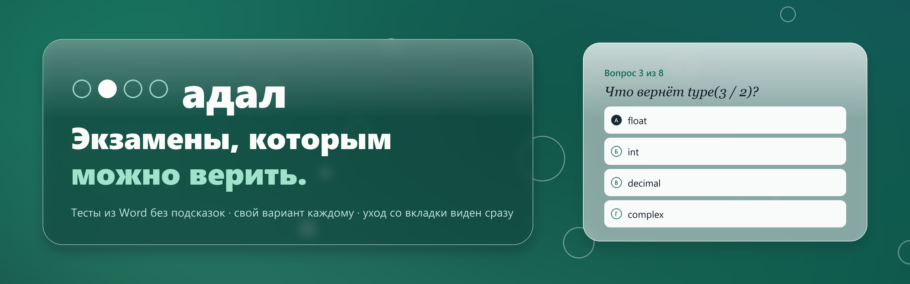
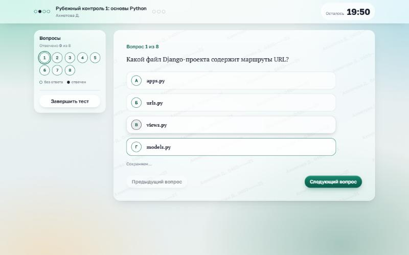
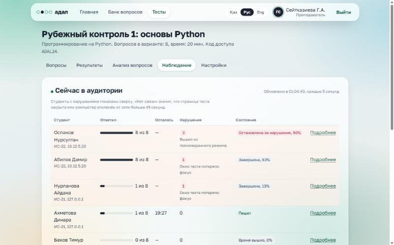
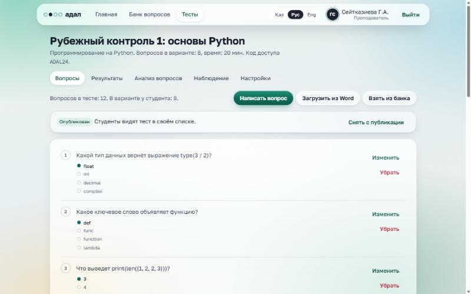
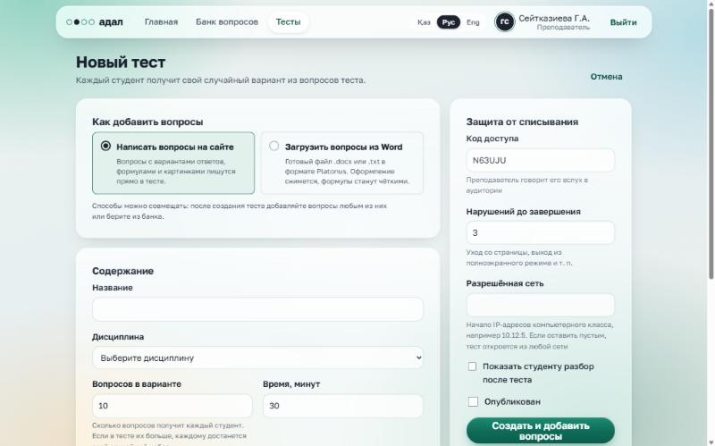
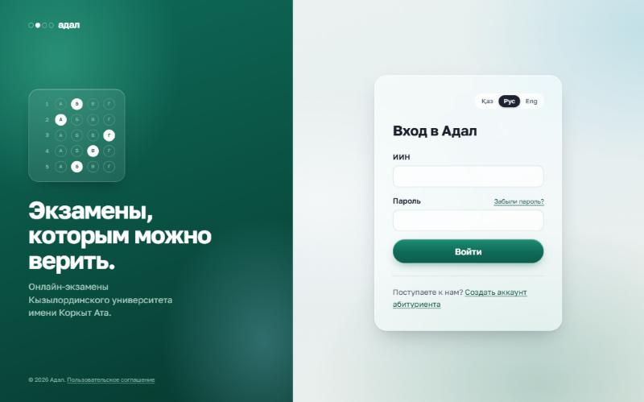
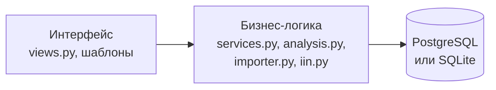

<p align="center">
  
</p>

<p align="center">
  <a href="https://adal-murex.vercel.app"><b>Открыть демо</b></a>
  &nbsp;·&nbsp;
  <a href="https://youtu.be/JhA1drR9xKM">Ролик за 90 секунд</a>
  &nbsp;·&nbsp;
  <a href="#попробовать">Логины для входа</a>
  &nbsp;·&nbsp;
  <a href="#куда-растёт-адал">План развития</a>
  &nbsp;·&nbsp;
  <a href="docs/README.md">Документация</a>
</p>

<p align="center">
  
  
  
  
  
</p>

**Адал** («честный» по-казахски) помогает вузам проводить экзамены в компьютерных
классах так, чтобы оценке можно было верить. Преподаватель загружает привычный Word-файл или пишет вопросы прямо на сайте,
каждый студент получает свой вариант, время считает сервер, а уход на вкладку с
ChatGPT видно на экране преподавателя через пять секунд. После экзамена система сама
показывает вопросы с ошибкой в ключе.

Работает в браузере, ничего не нужно устанавливать: ни на компьютеры аудитории, ни
студентам. Интерфейс на казахском, русском и английском.



## Зачем это вузу

Экзамены в вузах Казахстана часто проходят через Platonus, и в нём есть места, где
оценка перестаёт быть честной.

Правильный вариант в Word-файле часто выделен жирным, и это попадает студенту на
экран. Формулы вставлены картинками и плохо читаются. У всей группы один и тот же
вариант, поэтому ответ передают по ряду. А в соседней вкладке открыт ChatGPT или
«Спросить Gemini» по правой кнопке, и из-за стола преподавателя этого не видно.

Адал закрывает каждую из этих дыр, и преподавателю не нужно переделывать свои тесты.

| Проблема | Что делает Адал |
|---|---|
| Ответ выдаёт оформление Word | При загрузке жирный, курсив и цвет снимаются, преподаватель видит предупреждение «правильный ответ был выделен» |
| Формулы картинками | Формулы из редактора Word переводятся в LaTeX и чётко видны на любом экране |
| Ответ ищут в соседней вкладке | Тест идёт на весь экран, уход со страницы виден в «Наблюдении», после лимита тест завершается сам |
| Ответ передают по ряду | Свой набор вопросов и порядок ответов у каждого, вход по коду из аудитории и, при желании, только из сети класса |
| Ошибку в ключе никто не замечает | Анализ каждого вопроса: трудность, различающая способность, варианты, которые никто не выбирает |

## Как это работает

1. Преподаватель нажимает «Создать тест» или «Загрузить тест из Word», задаёт время,
   группы и код доступа.
2. Добавляет вопросы: пишет на сайте с формулами и картинками, загружает файл в формате
   Platonus или берёт готовые из общего банка.
3. Публикует тест и в аудитории называет код. Студенты входят по ИИН.
4. Во время экзамена смотрит «Наблюдение»: кто сколько ответил и кто уходил со страницы.
5. После экзамена получает результаты с выгрузкой в Excel и разбор каждого вопроса.

<table>
  <tr>
    <td width="50%"></td>
    <td width="50%"></td>
  </tr>
  <tr>
    <td><sub>Наблюдение: нарушения видны сразу, строки с ними поднимаются наверх.</sub></td>
    <td><sub>Вопросы теста: написать, загрузить из Word или взять из банка.</sub></td>
  </tr>
  <tr>
    <td width="50%"></td>
    <td width="50%"></td>
  </tr>
  <tr>
    <td><sub>Новый тест создаётся черновиком и публикуется, когда вопросов хватает.</sub></td>
    <td><sub>Вход по ИИН с проверкой контрольной цифры.</sub></td>
  </tr>
</table>

## Чем Адал отличается

| | Адал | Platonus | Moodle Quiz | Google Forms |
|---|:---:|:---:|:---:|:---:|
| Снимает подсказки в оформлении Word | ● | ○ | ○ | ○ |
| Формулы текстом, а не картинкой | ● | ○ | ● | ○ |
| Уход со вкладки виден в реальном времени | ● | нет данных | ◐ | ○ |
| Свой вариант каждому студенту | ● | ● | ● | ◐ |
| Находит ошибки в ключе ответов | ● | нет данных | ◐ | ○ |
| Импорт тестов в формате Platonus | ● | ● | ◐ | ○ |

● есть, ◐ частично или через дополнения, ○ нет. Сравнение по открытым источникам на
ноябрь 2026 года.

Moodle сильнее по числу типов вопросов и интеграций, а Адал сделан под одну задачу:
честный итоговый экзамен в компьютерном классе без долгой настройки.

## Что уже работает

**Для преподавателя.** Тесты на сайте и из Word, общий банк вопросов с поиском,
фильтрами и сортировками, формулы и картинки, черновики и публикация, наблюдение в
реальном времени, результаты с выгрузкой, анализ вопросов, профиль со статистикой по
своим тестам.

**Для студента.** Вход по ИИН, регистрация абитуриента в три шага, свой вариант, таймер
на сервере, сохранение каждого ответа сразу, разбор после теста, профиль с динамикой
результатов и успехами по дисциплинам. Удобно и на компьютере, и на телефоне.

**Для администратора.** Пересдача: студенту, который провалился или был остановлен за
нарушения, можно заново открыть тест даже после закрытия. Прошлая попытка остаётся в
истории.

**Защита и данные.** Тест только в одном браузере, водяной знак с ФИО, код доступа и
ограничение по сети аудитории, правая кнопка и копирование заблокированы. Данные и
картинки хранятся в PostgreSQL, каждая версия проходит 118 автотестов.

## Куда растёт Адал

План собран по итогам разбора конкурентов и трендов онлайн-экзаменов.

**Ближайший релиз**
- Исправление ключа в один клик с пересчётом оценок всей группы.
- Поиск пар студентов со слишком похожими неверными ответами.
- Новые типы вопросов: несколько верных ответов, соответствие, порядок, числовой ответ.
- Решение по каждому нарушению принимает преподаватель: подтвердить или снять.

**Пилот в университете**
- Вход через eGov QR, чтобы на экзамен нельзя было прийти вместо другого.
- Режим Safe Exam Browser: на компьютерах класса нельзя открыть другие программы.
- Сервер в Казахстане и резервное копирование.

**Дальше**
- ИИ-помощник: черновик вопросов по лекции, который преподаватель проверяет и правит.
- Адаптивные тесты, которые подбирают следующий вопрос по уровню студента.
- Интеграция с Moodle и другими системами вуза по стандарту LTI 1.3.

## Попробовать

Демо: **[adal-murex.vercel.app](https://adal-murex.vercel.app)**. Пароль у всех
демо-аккаунтов `adal2026`.

| Роль | ИИН |
|---|---|
| Администратор | `800101300016` |
| Преподаватель | `620315400078` |
| Студент | `040202501016` (ещё `040101601003`, `040303601021`, `040404501034`) |

Код доступа к открытому тесту: `ADAL24`.

Лучше всего видно в двух окнах: студентом начните тест, преподавателем откройте
«Наблюдение», потом у студента переключитесь на другую вкладку.

## Запустить у себя

Нужен Python 3.11 или новее.

```bash
git clone https://github.com/murwqq/adal.git
cd adal
python -m venv .venv
.venv\Scripts\activate            # Linux и macOS: source .venv/bin/activate
pip install -r requirements.txt
python manage.py migrate
python manage.py seed_demo        # демо-пользователи, вопросы и тесты
python manage.py runserver
```

Сайт откроется на http://127.0.0.1:8000. Без переменной `DATABASE_URL` используется
SQLite, с ней PostgreSQL. Тесты: `python -m pytest`. Установка на сервер и на Vercel
описана в [инструкции](docs/08-install.md).

## Как устроен код



Логика экзаменов (варианты, таймер, нарушения, импорт, анализ) живёт в `services.py`
и соседних модулях и не зависит от веба, поэтому её можно подключить к мобильному или
настольному клиенту. Стек: Django 6, PostgreSQL (Neon), python-docx и lxml для Word,
Pillow, KaTeX, pytest. Хостинг на Vercel. Подробнее в
[описании архитектуры](docs/03-architecture.md).

## Документация

Техническое задание, архитектура, маршруты, план тестирования, руководство
пользователя, установка и чек-лист безопасности собраны в [docs](docs/README.md).

## Команда

**Мұхтарұлы Мұратхан** и **Төребек Едіге**. Адал вырос из проекта в Кызылординском
университете имени Коркыт Ата, где мы учимся в группе СИБ-24-1 п/я.

Нашли ошибку или хотите попробовать Адал в своём вузе, откройте
[issue](https://github.com/murwqq/adal/issues).
