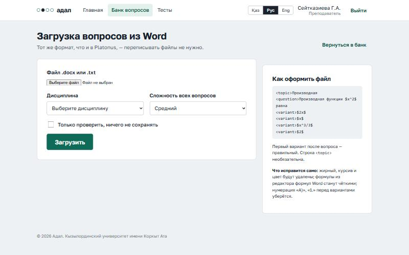
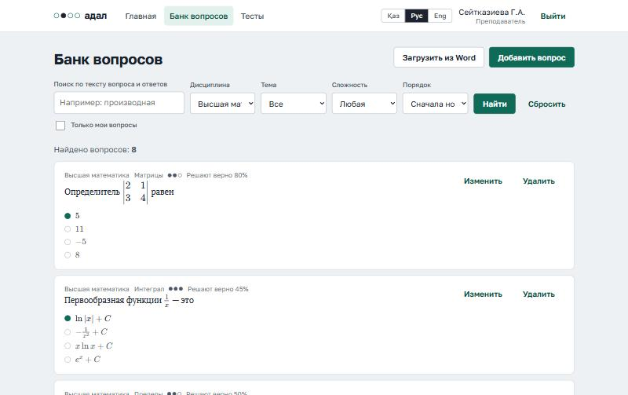
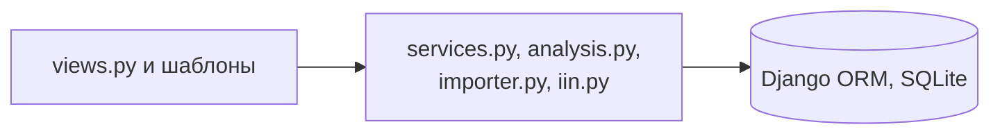

<p align="center">
  
</p>

<p align="center">
  <a href="https://adal-murex.vercel.app"><b>Открыть демо</b></a>
  &nbsp;·&nbsp;
  <a href="#попробовать-за-минуту">Логины для входа</a>
  &nbsp;·&nbsp;
  <a href="docs/README.md">Документация</a>
</p>

<p align="center">
  
  
  
  
</p>

Адал по-казахски значит «честный». Это система для экзаменов в компьютерном классе.
Преподаватель загружает тест из того же Word-файла, что и для Platonus. Каждый студент
получает свой вариант, время считает сервер, а если кто-то ушёл со страницы спросить
ChatGPT, преподаватель видит это сразу.


## С чего всё началось

Кто сдавал тесты в Platonus, знает про две дыры.

Первая: правильный ответ в Word часто выделен жирным или другим шрифтом, и это
доезжает до студента. Отвечать можно по оформлению, не читая вопрос. Формулы при этом
вставлены картинками, и половину из них не разобрать.

Вторая: тест идёт в браузере, а в соседней вкладке открыт ChatGPT или Gemini. Правая
кнопка, «спросить», ответ готов. Со стороны преподавателя ничего не видно.

Мы решили сделать систему, где обе проблемы закрыты, и при этом преподавателю не
нужно переделывать свои тесты.

## Что получилось

**Word без подсказок.** Файл в формате Platonus (`<question>`, `<variant>`, первый
вариант правильный) загружается как есть. Жирный, курсив и цвет снимаются. Если
правильный ответ был выделен, преподаватель получает предупреждение: студенты могли
это видеть. Формулы из редактора формул Word переводятся в LaTeX и показываются
чётко при любом масштабе.

**Уход со страницы виден.** Тест открывается на весь экран. Переключение вкладки и
выход из полноэкранного режима записываются как нарушения, и преподаватель видит их на
экране наблюдения. После заданного числа нарушений тест завершается сам. Правая кнопка
(через неё в Chrome открывается «Спросить Gemini»), копирование и вставка просто не
работают, но нарушением не считаются: их легко нажать случайно. На странице водяной знак с ФИО студента, так что
фото экрана тоже не анонимное.

**У каждого свой вариант.** Вопросы и порядок ответов перемешиваются для каждого
студента. Попасть в тест можно только с кодом, который преподаватель пишет на доске,
и при желании только из сети аудитории.

**Время считает сервер.** Таймер на странице только показывает остаток. Перевести
часы на компьютере или перезагрузить страницу бесполезно: ответы сохраняются сразу,
а после дедлайна сервер их не примет.

**После теста видно, какие вопросы плохие.** Для каждого вопроса считаются трудность
и различающая способность, отмечаются варианты, которые никто не выбирал. Если
сильные студенты массово ошибаются в одном вопросе, скорее всего, в ключе ошибка.

<table>
  <tr>
    <td width="50%"></td>
    <td width="50%"></td>
  </tr>
  <tr>
    <td><sub>Наблюдение: кто сколько ответил и кто уходил со страницы.</sub></td>
    <td><sub>Анализ вопросов после теста.</sub></td>
  </tr>
  <tr>
    <td width="50%"></td>
    <td width="50%"></td>
  </tr>
  <tr>
    <td><sub>Загрузка из Word с предупреждениями.</sub></td>
    <td><sub>Банк вопросов: поиск, фильтры, сортировка.</sub></td>
  </tr>
</table>

Ещё по мелочи: вход по ИИН с проверкой контрольной цифры, регистрация абитуриента
как в Platonus, выгрузка результатов в Excel, интерфейс на казахском, русском и
английском. Остальные экраны лежат в [макетах интерфейса](docs/04-ui.md).

## Попробовать за минуту

Демо: **[adal-murex.vercel.app](https://adal-murex.vercel.app)**. Пароль у всех
аккаунтов `adal2026`.

| Кто | ИИН |
|---|---|
| Преподаватель | `620315400078` |
| Студент | `040202501016` (есть ещё `040101601003`, `040303601021`, `040404501034`) |

Код доступа к открытому тесту: `ADAL24`. Демо-база иногда сбрасывается, так что
ничего важного там не храните.

Совет: зайдите студентом в одной вкладке, а преподавателем в другом браузере, и
откройте экран наблюдения. Потом в тесте переключитесь на другую вкладку и
посмотрите, что увидит преподаватель.

## Запустить у себя

Нужен Python 3.11 или новее.

```bash
git clone https://github.com/murwqq/adal.git
cd adal
python -m venv .venv
.venv\Scripts\activate            # Linux и macOS: source .venv/bin/activate
pip install -r requirements.txt
python manage.py migrate
python manage.py seed_demo        # демо-пользователи, вопросы и тесты
python manage.py runserver
```

Дальше открываете http://127.0.0.1:8000 и входите с логинами из таблицы выше.
Тесты запускаются командой `python -m pytest`. Как поставить на сервер или на Vercel,
написано в [инструкции по установке](docs/08-install.md).

## Как устроен код



Вся логика (варианты, таймер, нарушения, импорт, анализ) лежит в `services.py` и
соседних модулях и не знает про HTTP. Views только принимают запрос и рисуют шаблон.
`iin.py` и `analysis.py` вообще не зависят от Django.

Стек: Django 6, SQLite (для продакшена подойдёт PostgreSQL), python-docx и lxml для
Word, Pillow для картинок и капчи, KaTeX для формул, pytest для тестов. Демо крутится
на Vercel. Подробности в [описании архитектуры](docs/03-architecture.md).

## Документы

Это курсовой проект, поэтому к нему есть полный комплект документов по учебному
пособию (вариант 9): [анализ](docs/01-analysis.md), [ТЗ](docs/02-requirements.md),
[архитектура](docs/03-architecture.md), [макеты](docs/04-ui.md),
[маршруты](docs/05-routes.md), [план и отчёт тестирования](docs/06-test-plan.md),
[руководство пользователя](docs/07-user-guide.md), [установка](docs/08-install.md),
[пояснительная записка](docs/09-explanatory-note.md) и
[чек-лист безопасности](docs/11-security-checklist.md).

## Авторы

Мұхтарұлы Мұратхан и Төребек Едіге, группа СИБ-24-1 п/я,
Кызылординский университет имени Коркыт Ата, 2026.

Сделано как учебный проект по дисциплине «Программирование на языке Python».
Если нашли баг, откройте issue.
