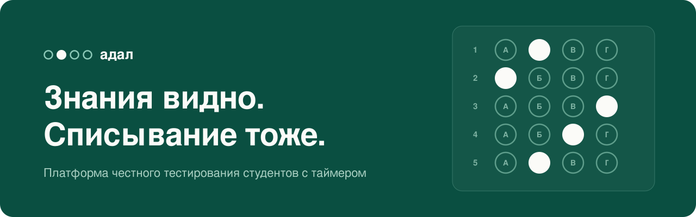
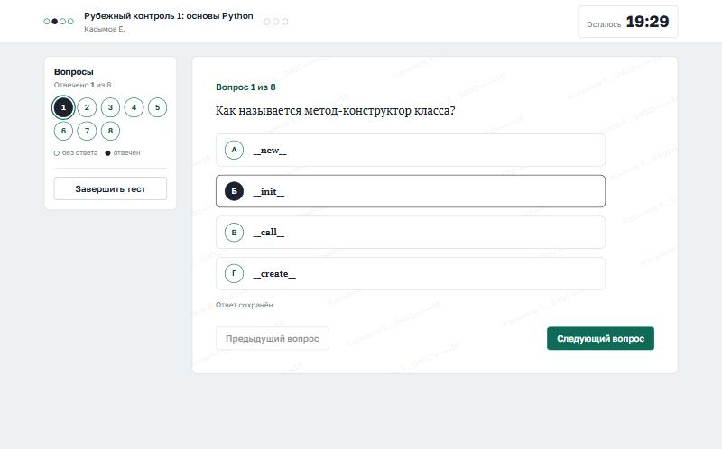
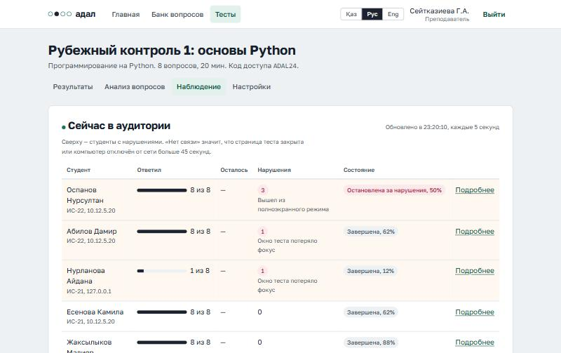
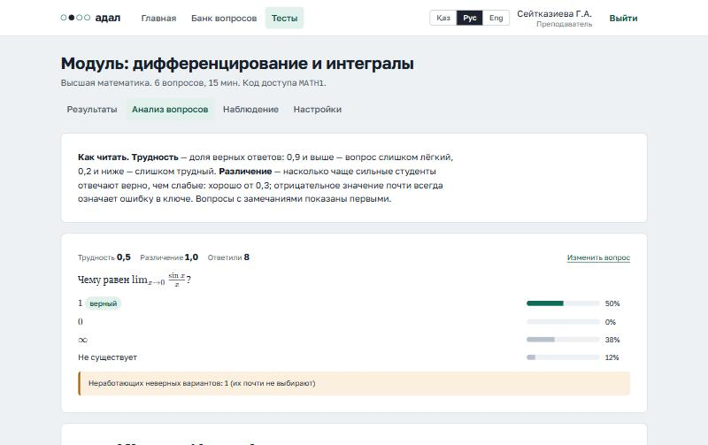
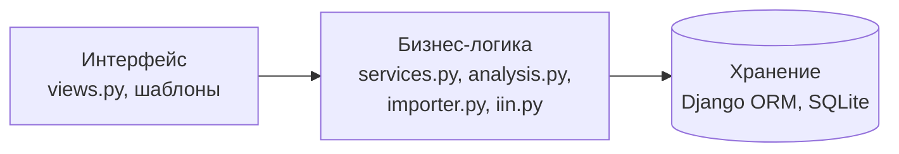

<p align="center">
  
</p>

<p align="center">
  <a href="https://adal-murex.vercel.app"></a>
  <a href="docs/README.md"></a>
</p>

<p align="center">
  
  
  
  
  
</p>

**Адал** («честный» по-казахски) — веб-платформа для экзаменов в компьютерных аудиториях.
Преподаватель загружает привычные тесты из Word, каждый студент получает свой вариант,
время считает сервер, а уход на вкладку с ИИ-помощником сразу виден в аудитории.

## Зачем

В тестах, которые проходят в университетах через Platonus, есть две слабости.

| Было | Стало в Адал |
|---|---|
| Правильный вариант в Word выделен жирным, и студент угадывает ответ по оформлению | Оформление снимается при загрузке, а преподаватель видит предупреждение «правильный ответ был выделен» |
| Формулы вставлены картинками и читаются плохо | Формулы из редактора формул Word становятся чёткими (LaTeX) |
| Студент открывает ChatGPT в соседней вкладке, и этого никто не видит | Уход со страницы, выход из полноэкранного режима, правая кнопка и копирование фиксируются, после лимита тест завершается |
| Все пишут одинаковый вариант | Свой набор вопросов и порядок ответов у каждого, водяной знак с ФИО, код доступа из аудитории |

## Как это выглядит

<table>
  <tr>
    <td width="50%"><br><sub><b>Экран теста.</b> Один вопрос, таймер, сетка ответов как на бланке.</sub></td>
    <td width="50%"><br><sub><b>Наблюдение.</b> Кто сколько ответил и кто уходил со страницы — в реальном времени.</sub></td>
  </tr>
  <tr>
    <td width="50%"><br><sub><b>Загрузка из Word.</b> Тот же формат, что в Platonus, без переделки файлов.</sub></td>
    <td width="50%"><br><sub><b>Анализ вопросов.</b> Трудность, различение и подсказка, где ошибка в ключе.</sub></td>
  </tr>
</table>

Все экраны — в [макетах интерфейса](docs/04-ui.md).

## Возможности

**Для преподавателя**
- банк вопросов с формулами, поиском по тексту вопросов и ответов, фильтрами и шестью сортировками;
- загрузка тестов из .docx и .txt с проверкой подсказок в оформлении;
- тесты с окном времени, группами, кодом доступа и ограничением по сети аудитории;
- наблюдение в реальном времени, результаты с выгрузкой в Excel, анализ каждого вопроса.

**Для студента**
- вход по ИИН, регистрация абитуриента в три шага с проверкой ИИН;
- свой вариант, таймер, сохранение каждого ответа сразу;
- результат и разбор ответов после теста.

**Для всех** — интерфейс на казахском, русском и английском.

## Попробовать

Откройте [демо](https://adal-murex.vercel.app). Пароль у всех демо-аккаунтов — `adal2026`.

| Роль | ИИН |
|---|---|
| Преподаватель | `620315400078` |
| Студент | `040202501016`, `040101601003`, `040303601021`, `040404501034` |

Код доступа к открытому тесту — `ADAL24`. Демо-данные время от времени сбрасываются.

## Запуск у себя

```bash
git clone https://github.com/EVMura/adal.git
cd adal
python -m venv .venv
.venv\Scripts\activate            # Linux и macOS: source .venv/bin/activate
pip install -r requirements.txt
python manage.py migrate
python manage.py seed_demo        # демо-пользователи, вопросы и тесты
python manage.py runserver
```

Сайт откроется на http://127.0.0.1:8000. Тесты: `python -m pytest`.
Установка на сервер и на Vercel — в [инструкции](docs/08-install.md).

## Как устроено



Бизнес-логика не зависит от веба: её можно подключить к настольной или мобильной версии.
Подробнее — в [описании архитектуры](docs/03-architecture.md).

| Часть | Технология |
|---|---|
| Сервер | Python 3.11+, Django 6 |
| База | SQLite (PostgreSQL для продакшена) |
| Word и картинки | python-docx, lxml, Pillow |
| Формулы | LaTeX, KaTeX |
| Тесты | pytest, pytest-django, coverage |
| Хостинг | Vercel |

## Документация

Полный комплект по учебному пособию, вариант 9:

| Документ | |
|---|---|
| Анализ задачи и аналогов | [01-analysis.md](docs/01-analysis.md) |
| Техническое задание | [02-requirements.md](docs/02-requirements.md) |
| Архитектура | [03-architecture.md](docs/03-architecture.md) |
| Макеты интерфейса | [04-ui.md](docs/04-ui.md) |
| Маршруты | [05-routes.md](docs/05-routes.md) |
| План и отчёт тестирования | [06-test-plan.md](docs/06-test-plan.md) |
| Руководство пользователя | [07-user-guide.md](docs/07-user-guide.md) |
| Установка и развёртывание | [08-install.md](docs/08-install.md) |
| Пояснительная записка | [09-explanatory-note.md](docs/09-explanatory-note.md) |
| Чек-лист безопасности | [11-security-checklist.md](docs/11-security-checklist.md) |

## Авторы

**Мұхтарұлы Мұратхан** и **Төребек Едіге**, группа СИБ-24-1 п/я.
Кызылординский университет имени Коркыт Ата, 2026.

Учебный проект по дисциплине «Программирование на языке Python».
