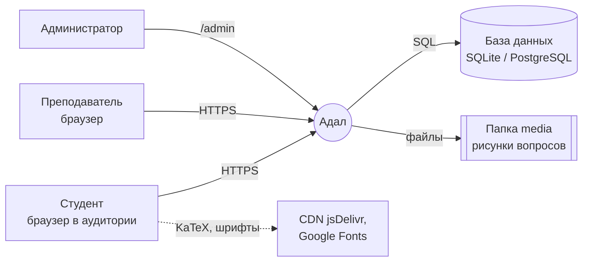
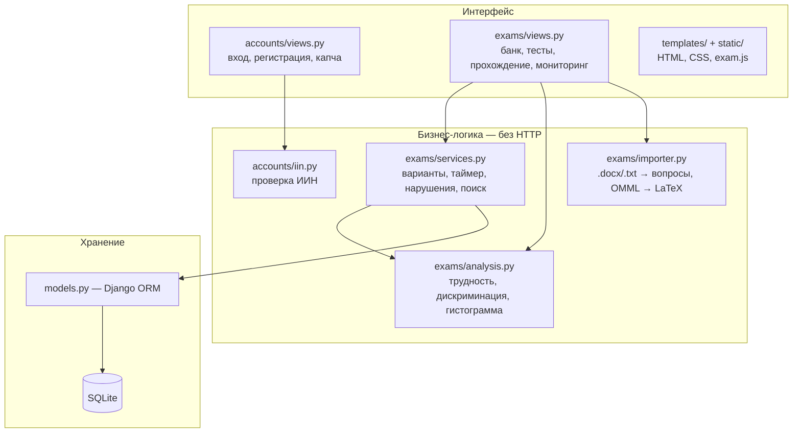
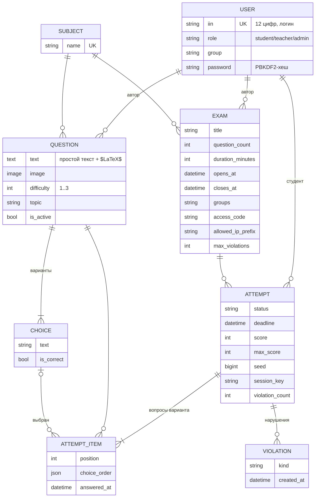
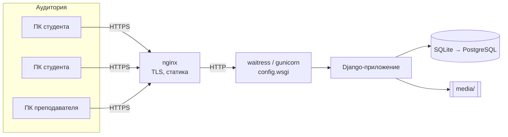

# 3. Описание архитектуры

## 3.1 Назначение и контекст

## 3.2 Слои и компоненты

Применена трёхуровневая схема из пособия (раздел 2.3): интерфейс → бизнес-логика → хранение.
Бизнес-логика не зависит от HTTP, поэтому её можно вызвать из веб-интерфейса, консоли
(`seed_demo`) или тестов.

`analysis.py`, `importer.py`, `iin.py` — чистые функции без Django: их можно перенести в
настольное или мобильное приложение без изменений.

## 3.3 Схема базы данных

Ограничения целостности на уровне БД: `UNIQUE(exam, student)` — одна попытка;
`UNIQUE(attempt, position)` — без дублей в варианте; `UNIQUE(iin)`; `UNIQUE(subject.name)`.

## 3.4 Ключевые решения

| Решение | Альтернативы | Почему так |
|---|---|---|
| Django | Flask, FastAPI | В пособии оба допустимы; Django даёт ORM, аутентификацию, CSRF, админку и i18n «из коробки» — меньше своего кода безопасности |
| Таймер на сервере (`deadline` в БД) | Таймер только в браузере | Браузерный таймер можно остановить или подделать. JS лишь показывает время и раз в 10 с сверяется с сервером |
| Запас 5 с после дедлайна (`GRACE_SECONDS`) | Строгий дедлайн | Ответ, отправленный в последнюю секунду, не теряется из-за сетевой задержки |
| Вариант через `random.Random(seed)` | Случайность при каждом запросе | Вариант воспроизводим по `seed` (можно разобрать спорную ситуацию), а порядок хранится в `choice_order` |
| Один вопрос на экране, подгрузка без перезагрузки | Все вопросы на одной странице | Переход на новую страницу сбрасывает полноэкранный режим; в DOM только текущий вопрос — меньше текста для ИИ-расширений |
| Антидребезг нарушений 3 с | Каждое событие отдельно | Переключение вкладки порождает сразу `blur` и `visibilitychange` — это одно действие студента |
| Вопросы хранятся простым текстом + LaTeX | HTML-редактор | Оформление физически невозможно, значит, оно не выдаст ответ |
| Своя функция `py_lower` для SQLite | `icontains` | Встроенные LOWER/LIKE в SQLite не знают регистра кириллицы |
| SQLite | PostgreSQL | Для учебного проекта не нужен отдельный сервер. Ограничение: одна запись в момент времени — на 25–30 студентов аудитории достаточно; при росте — PostgreSQL (одна настройка в `settings.py`) |

## 3.5 Граничный случай: время теста

Дедлайн попытки = `min(started_at + duration, exam.closes_at)`. Студент, начавший за 3 минуты
до закрытия теста, получает 3 минуты, а не всю длительность — это проверяет тест
`test_deadline_limited_by_exam_close`. Ответ принимается до `deadline + 5 с` включительно.

## 3.6 Схема развёртывания

Подробнее — в [инструкции по установке](08-install.md).
