# 4. Макеты интерфейса

Скриншоты сняты с текущей версии приложения (демо-данные `seed_demo`, окно 1366×850).

**Визуальная идея — бланк ответов.** Бланк «напечатан» спокойной зелёной краской, отметки
студента сделаны графитом: закрашенный кружок = выбранный ответ, ряды кружков = номера
вопросов. Основной шрифт — Golos Text 17 px (крупнее обычного: интерфейсом пользуются
преподаватели старшего возраста), вопросы набраны шрифтом с засечками PT Serif.

## Вход
Вход по ИИН и паролю, переключатель языка, ссылка на регистрацию абитуриента.

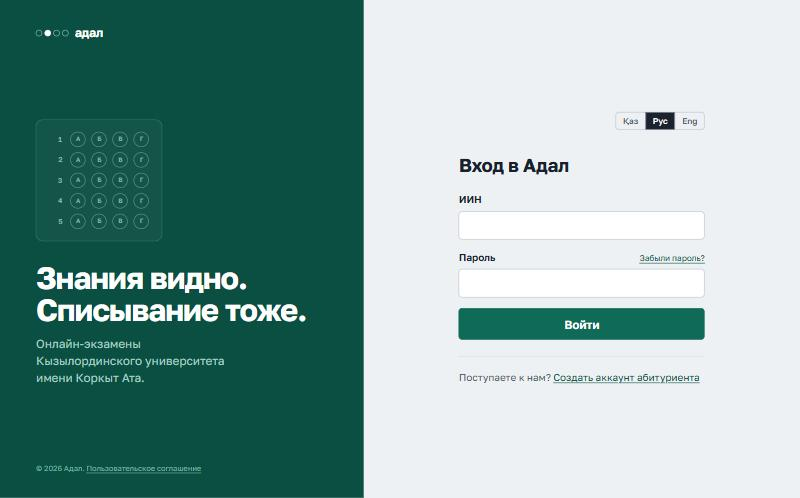

## Регистрация абитуриента
Поля Platonus разбиты на три шага: «Поступление» → «Личные данные» → «Пароль». ИИН проверяется
прямо при вводе (контрольная цифра, дата рождения). Без JavaScript все шаги видны сразу.

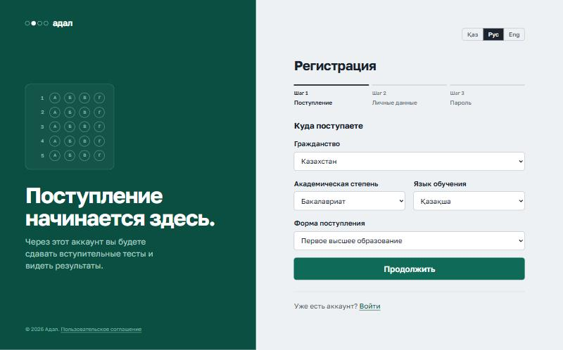

## Кабинет студента
Доступные тесты (с временем открытия) и пройденные (статус, балл).

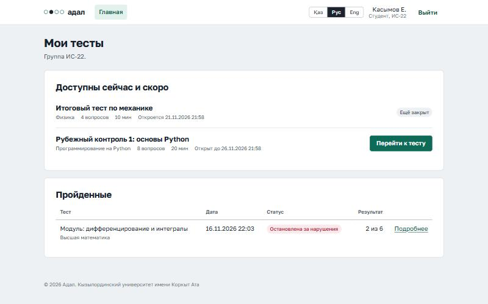

## Перед началом теста
Правила и поле кода доступа, который преподаватель называет в аудитории.

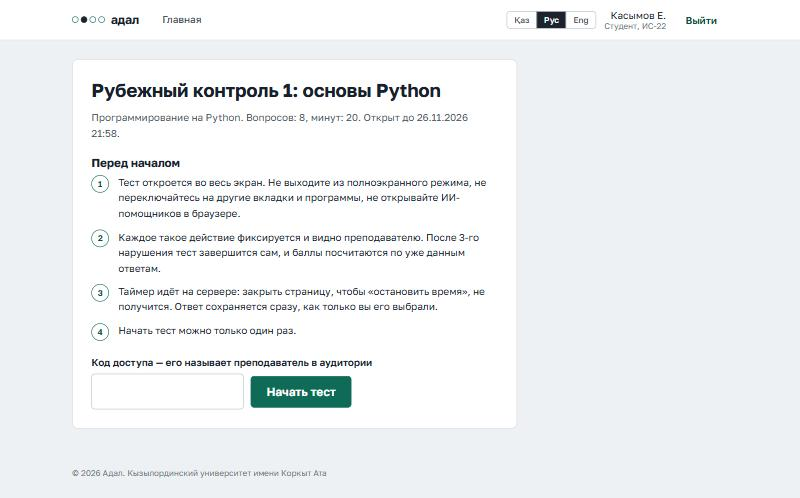

## Экран теста
Слева — сетка номеров вопросов (закрашен = отвечен), справа — один вопрос. Сверху — таймер
(жёлтый за 5 мин, красный за 1 мин) и индикатор нарушений. На листе — едва заметный водяной
знак с фамилией и маскированным ИИН.

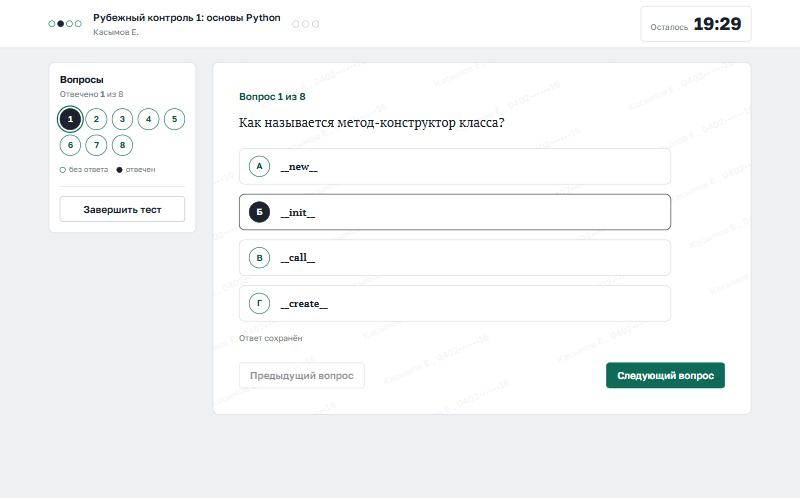

## Результат
Балл и (если преподаватель разрешил) разбор ответов, список зафиксированных нарушений.

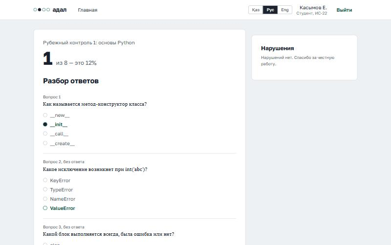

## Кабинет преподавателя
Мои тесты с кнопкой «Наблюдать», дисциплины с числом вопросов, подсказка по формулам.

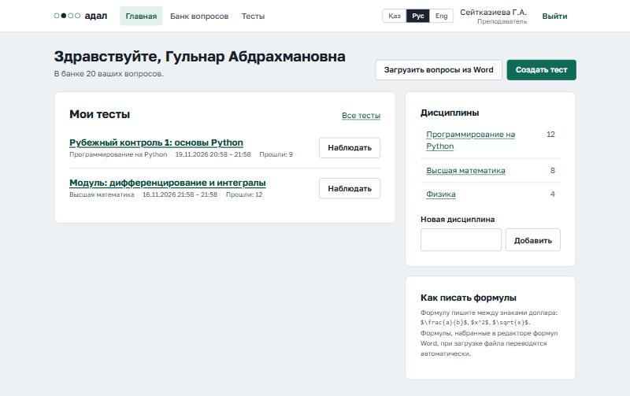

## Банк вопросов — поиск, фильтры, сортировка
Поиск по тексту вопросов и ответов, фильтры по дисциплине, теме, сложности, «только мои»,
шесть видов сортировки (в т. ч. «хуже всего решают»). Формулы показаны так, как их увидит студент.

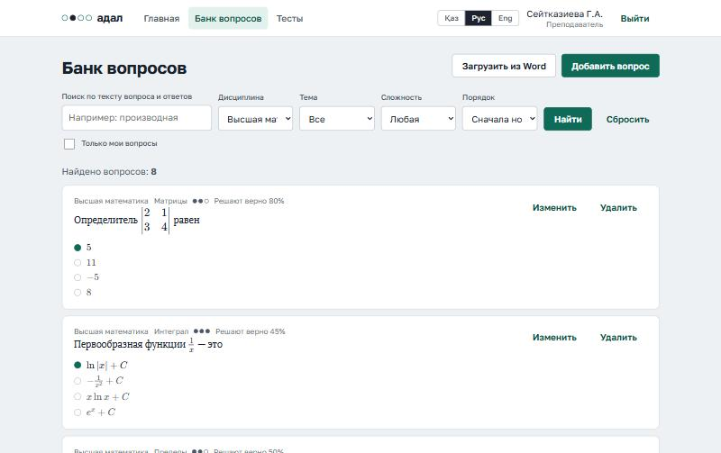

## Редактор вопроса
Кнопки-шаблоны формул и предпросмотр «Так увидит студент». Правильный ответ отмечается кружком.

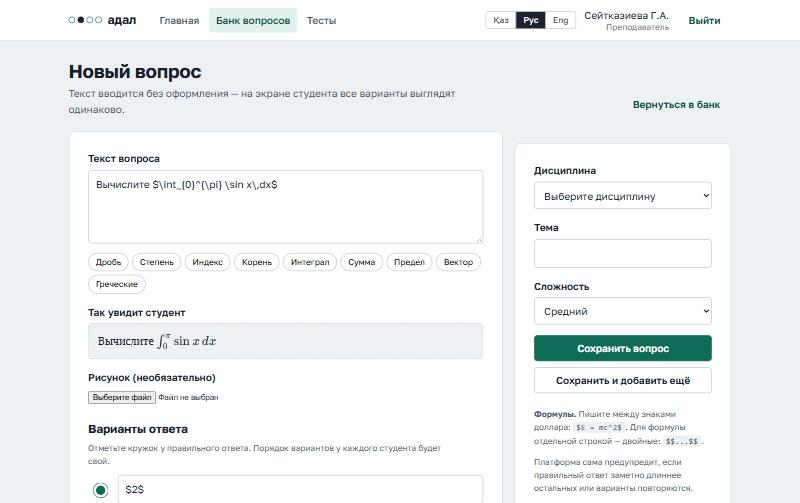

## Загрузка из Word
Тот же формат, что в Platonus. Режим «Только проверить» показывает замечания без сохранения.

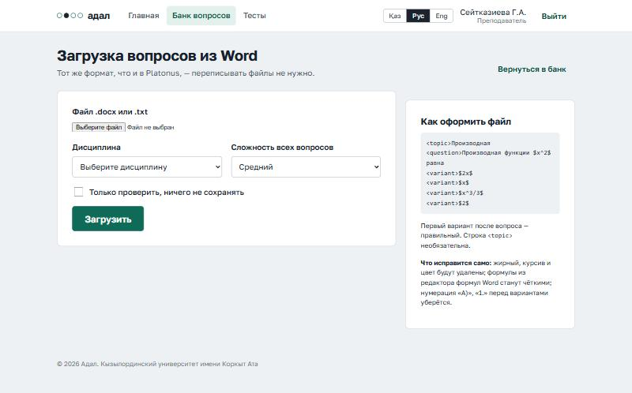

## Результаты теста
Сводка (сколько завершили, среднее, медиана, разброс), гистограмма, поиск/фильтры/сортировка,
выгрузка CSV.

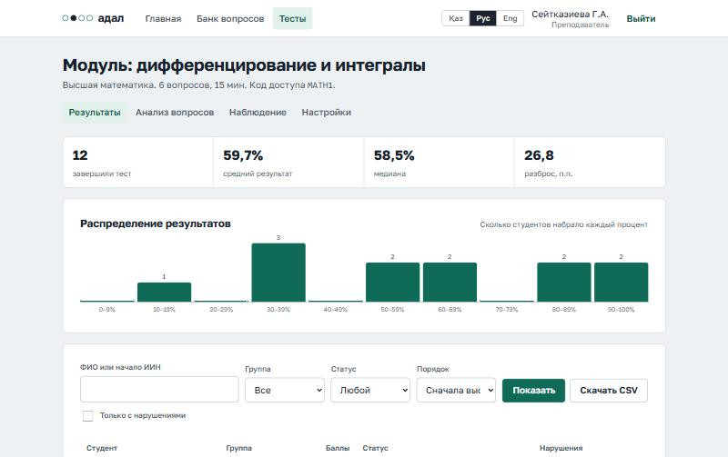

## Анализ вопросов
Трудность, различение и доли выбора каждого варианта. Вопросы с замечаниями — первыми.

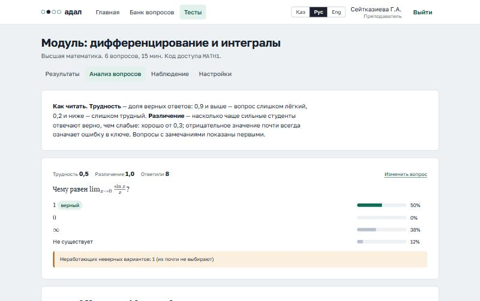

## Настройки теста
Содержание, время и группы, отдельный блок «Защита от списывания».

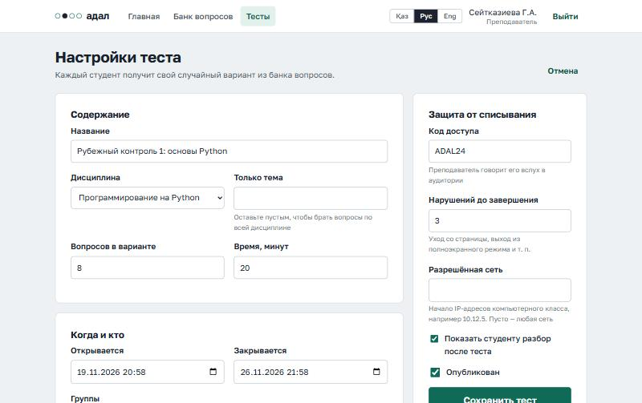

## Наблюдение в реальном времени
Обновляется каждые 5 секунд; студенты с нарушениями — сверху.

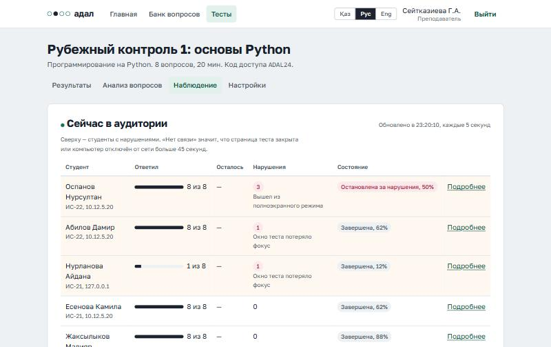

## Другие языки
Банк вопросов на казахском и результаты на английском. Содержимое вопросов не переводится —
это текст преподавателя.

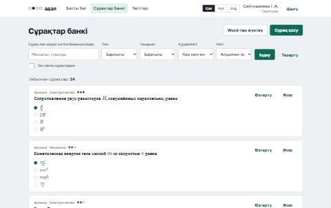
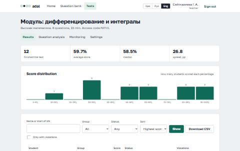
